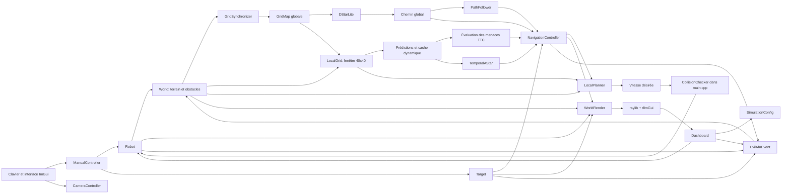

# Documentation technique complète de RobotNavigation2

## 1. Périmètre et méthode

Ce document décrit le code présent dans le dépôt et la cible configurée par
`CMakeLists.txt`. Il ne décrit pas une architecture souhaitée. Les fichiers
historiques non inclus dans cette cible sont distingués du programme actif.
L'analyse a été effectuée en lecture seule; aucune compilation ou exécution de
la simulation n'a été effectuée pour cette mission.

L'application active est un programme C++17 qui utilise raylib pour la fenêtre,
le rendu 3D et les entrées, ainsi que Dear ImGui raccordé à raylib par
`rlImGui`.

## 2. Organisation du dépôt

| Chemin | Contenu et rôle |
|---|---|
| `src/main.cpp` | Point d'entrée effectivement compilé; construit le monde, les contrôleurs et les planificateurs, puis exécute la simulation et le rendu. |
| `src/core/` | Structures de configuration et état de navigation. |
| `src/monde/` | Terrain, obstacles, monde simulé et événement Evil Ahr. |
| `src/robot/`, `src/cible/` | État, commandes et intégration du robot et de la cible. |
| `src/input/` | Contrôleurs actifs du robot/cible et de la caméra, plus des fichiers historiques non compilés par la cible principale. |
| `src/planification/` | Carte discrète globale, synchronisation World→GridMap et D* Lite. |
| `src/navigation/` | Grille locale, évitement local, suivi du chemin, Temporal A*, prédictions et coordination. |
| `src/physics/` | Vérification géométrique des positions et déplacements contre le terrain et les obstacles. |
| `src/rendering/` | Dessin du terrain, des objets, des chemins et des visualisations de grille/prédiction. |
| `src/interface/` | Fenêtre ImGui et ses contrôles/diagnostics. |
| `tests/` | Tests C++ de navigation temporelle, de mouvement, d'Evil Ahr et un fichier de géométrie non raccordé à CTest. |
| `external/rlImGui/` | Sources rlImGui, Dear ImGui et exemples/fichiers annexes du dépôt externe. |
| `build/`, `build-msvc/` | Répertoires de génération et de compilation présents dans l'arborescence; leur contenu n'est pas le code source de l'application. |

Fichiers racine notables :

- `CMakeLists.txt` configure l'exécutable `RobotNavigation` et trois tests
  CTest.
- `README.md` est un court aide-mémoire de construction; il ne documente pas
  l'architecture actuelle et cite notamment Ninja comme outil alors que le
  générateur CMake est choisi par la commande de configuration.
- `CMakeLists.txt.backup`, les fichiers `.txt` de sortie/erreur, `imgui.ini`
  et `test_compiler.*` sont des sauvegardes, traces, préférences ou fichiers
  d'essai présents à la racine; ils ne sont pas déclarés comme sources de la
  cible CMake principale.

### Fichiers présents mais hors de la cible active

Le CMake actuel n'inclut pas :

- `src/main_2.cpp`, variante/expérimentation ancienne avec des références à
  une recherche Space-Time A* historique. Ce n'est pas le point d'entrée de
  l'application construite.
- `src/input/InputCamera.cpp` et `src/input/InputControlleur.cpp`, fragments
  d'une ancienne organisation des contrôles.
- `src/navigation/ObstaclePrediction.cpp`, qui contient une ancienne fonction
  `PredictObstaclePosition`; le programme actif prédit via
  `World::GetPredictedObstacleState`.
- `tests/NavigationGeometryTests.cpp`. Le fichier contient un `main` de test,
  mais il n'est pas déclaré dans le CMake actuel et fait référence à des
  fonctions `GridMap::IsStaticPositionFree`/`IsStaticMovementFree` absentes de
  l'interface actuelle de `GridMap`.

Ils ne doivent donc pas être considérés comme preuve d'un comportement exécuté
par le binaire courant.

## 3. Architecture d'ensemble



Le graphe est un flux de responsabilités, pas une exécution parallèle :
`main.cpp` orchestre les composants séquentiellement. Le contrôleur de
navigation mémorise les sous-systèmes et utilise leurs sorties dans un ordre
défini ci-dessous.

### Principales responsabilités

| Classe / structure | Responsabilité effective |
|---|---|
| `World` | Possède le terrain et le `std::vector<Obstacle>`, attribue les identifiants, déplace les obstacles mobiles, prédit leur état futur, et incrémente une révision lors de changements structurels. |
| `Obstacle` | Identifiant, centre et dimensions 3D, vitesse horizontale 2D et indicateur `isMoving`. |
| `Robot` | Position X/Z, vitesse X/Z, rayon et vitesse maximale; plafonne une commande à la vitesse maximale, puis intègre la position. |
| `Target` | Position et vitesse X/Z; la cible peut être déplacée par le contrôleur manuel et est intégrée comme le robot. |
| `GridMap` | Carte globale de cellules libres/bloquées et coûts; maintient les empreintes des obstacles statiques. |
| `GridSynchronizer` | Compare révision, terrain et marge, puis reporte les obstacles statiques de `World` vers `GridMap`. |
| `DStarLite` | Calcule et répare le chemin global sur `GridMap`. |
| `LocalGrid` | Fenêtre de 40×40 cellules, synchronisée avec la carte globale, et espace de stockage des obstacles dynamiques pertinents et de leurs prédictions. |
| `LocalPlanner` | Évalue des commandes/trajectoires locales sûres et renvoie la première vitesse d'une trajectoire retenue. |
| `TemporalAStar` | Recherche dans l'espace cellule-temps un détour local avec attentes possibles. |
| `PathFollower` | Convertit le chemin global et la cible en une vitesse désirée. |
| `NavigationController` | Met à jour les cartes et D* Lite, évalue les menaces dynamiques, déclenche et valide Temporal A*, puis combine le suivi et le LocalPlanner. |
| `CollisionChecker` | Vérifie la sécurité géométrique d'une position ou d'un segment complet. |
| `EvilAhrEvent` | Ajoute et retire ses propres obstacles sur/près du chemin, selon les paramètres d'événement. |
| `ManualController`, `CameraController` | Traduisent les entrées clavier/souris en mouvements du robot/de la cible et de la caméra. |
| `WorldRender`, `Dashboard` | Affichage raylib 3D et interface/diagnostics ImGui. |

## 4. Données et configuration

### `src/core/Config.h`

- `TerrainConfig` : `cellsX=400`, `cellsZ=400`, `cellSize=1`, `groundY=0`,
  `showGrid=true`. La géométrie du terrain est centrée sur l'origine.
- `RobotConfig` : rayon `0.65` et vitesse maximale `3 m/s`.
- `ObstacleGenerationConfig` : 25 obstacles, tailles 1–4, vitesses 0.5–2.5,
  probabilité mobile 0.5 et tailles aléatoires.
- `NavigationConfig` : `arrivalRadius=1`.
- `SimulationConfig` regroupe ces quatre configurations.

Les contrôles ImGui modifient ces structures en mémoire. Il n'y a pas de
chargement/enregistrement de ces paramètres dans un fichier de configuration.

### `src/core/NavigationState.h`

`NavigationState` ne contient que `Idle`, `Moving` et `TargetReached`. Il ne
distingue pas l'absence de route d'un arrêt volontaire : les deux se présentent
comme `Idle`.

### `src/core/Types.h`

Déclare aussi un `GridCell` avec opérateurs `==`/`!=`. Les fichiers actifs
utilisent principalement la définition `GridCell` de
`src/planification/GridMap.h`; `Types.h` n'est pas référencé par les sources
actives identifiées.

## 5. Simulation du monde et objets

### `Obstacle`

Dans `src/monde/Obstacle.h`, la géométrie est alignée sur les axes X/Z :

- `position` est le centre de la boîte;
- `size.x`, `size.y`, `size.z` sont ses dimensions;
- `velocity.x` agit sur X et `velocity.y` représente la vitesse de l'axe Z;
- `id=0` est la valeur par défaut, mais `World::AddObstacle` attribue son
  propre identifiant et ignore celui fourni par l'appelant;
- les obstacles statiques ont une vitesse remise à zéro.

### `World` (`src/monde/Monde.h/.cpp`)

Le constructeur assainit les dimensions du terrain (au moins une cellule,
cellule positive et hauteur finie). Les limites sont centrées sur l'origine.

- `GenerateObstacles` remplace le vecteur d'obstacles existant, incrémente la
  révision de navigation puis tente de produire chaque obstacle jusqu'à 100
  essais. Il choisit taille, position, mobilité, angle et vitesse; il protège
  les disques autour du robot et de la cible. Cette fonction ne garantit pas
  l'absence de chevauchement entre obstacles générés et n'impose pas elle-même
  le plafond de 200 affiché par l'interface.
- `AddObstacle` vérifie tailles et coordonnées horizontales finies/positives,
  valide la vitesse si l'obstacle bouge, contraint le centre au terrain, place
  l'obstacle sur le sol, lui affecte un ID et incrémente
  `navigationRevision`. Il ne vérifie pas les chevauchements.
- `RemoveObstacle(id)` retire le premier ID correspondant et incrémente la
  révision seulement si l'objet existait.
- `SetTerrain` assainit le terrain, incrémente la révision, recadre les
  obstacles existants et rétablit leur hauteur. Une modification de terrain
  peut immobiliser un axe si un obstacle est trop grand.
- `Update(dt)` s'exécute chaque frame. Les obstacles mobiles sont déplacés
  indépendamment sur X et Z selon un mouvement à réflexion aux limites; les
  obstacles statiques restent immobiles. Les déplacements d'obstacles ne
  modifient pas `navigationRevision`.
- `GetPredictedObstacleState(obstacle, futureTime)` reproduit la même
  réflexion en calculant l'état sans modifier le monde.

La révision est ainsi un signal structurel (ajout, suppression, remplacement
ou changement du terrain), et non un compteur de mouvement à chaque frame.

### `Robot` (`src/robot/Robot.h/.cpp`)

Le constructeur borne rayon et vitesse à zéro minimum. `SetVelocity` rejette
les composantes non finies en arrêtant le robot et normalise toute commande
plus rapide que `maxSpeed`. `Update(dt)` intègre `x += vx*dt` et
`z += vz*dt`; il n'y a pas de modèle d'accélération. `SetMaxSpeed` applique
immédiatement la nouvelle limite à la vitesse déjà présente. `Stop` annule la
vitesse.

### `Target` (`src/cible/Cible.h/.cpp`)

La cible expose `SetPosition`, `SetVelocity`, `Update`, `Stop` et des
accesseurs. Sa vitesse non finie provoque un arrêt. Elle n'a pas de limite
intégrée au terrain ni de collision propre; la navigation valide sa position
sur la grille globale. Dans le chemin principal, le contrôle manuel de la
cible règle sa vitesse, puis `Target::Update` change sa position.

## 6. Cartes, synchronisation et planification globale

### `GridMap` (`src/planification/GridMap.h/.cpp`)

La grille reprend la taille du terrain et est centrée sur l'origine. Elle
initialise ses cellules `Free` et ses coûts à 1.0.

- `WorldToCell` utilise `floor`; une position hors grille ou non finie échoue.
- `CellToWorld` retourne le centre de la cellule; une cellule invalide produit
  des coordonnées NaN.
- Une cellule a l'état `Unknown`, `Free` ou `Blocked`. Les coûts non finis,
  inférieurs à 1, ou assignés hors grille sont refusés. Un coût de cellule
  bloquée est infini.
- `GetCellsIntersectingRectangle` agrandit la boîte d'une marge de sécurité,
  découpe la zone au terrain et renvoie les cellules qu'elle recouvre.
- `UpdateStaticObstacle(id, ...)` mémorise l'empreinte cellule de chaque ID.
  `staticOccupancyCounts` permet qu'une cellule recouverte par plusieurs
  obstacles reste bloquée jusqu'au retrait du dernier.
- Le retrait enlève seulement l'empreinte de l'ID concerné et libère seulement
  les cellules dont le compteur retombe à zéro.
- Les changements sont regroupés par cellule dans `changedCells`; D* Lite les
  consomme par notifications et la navigation vide ensuite la liste.

### `GridSynchronizer` (`src/planification/GridSynchronizer.h/.cpp`)

`Synchronize(world, grid, safetyMargin)` compare la révision du monde, la
géométrie du terrain et la marge. Sans changement, il retourne `NoChange`.
Une géométrie différente entraîne un `Rebuild`; sinon il met à jour les
obstacles statiques présents et supprime des empreintes les IDs statiques
disparus. Les obstacles mobiles sont ignorés par cette carte globale. Les
résultats sont `NoChange`, `IncrementalUpdate` ou `FullRebuild`.

Une nouvelle marge de sécurité entraîne aussi une resynchronisation. Dans le
contrôleur actif, cette marge est le rayon du robot.

### `DStarLite` (`src/planification/DStarLite.h/.cpp`)

L'implémentation utilise les valeurs `g`/`rhs`, une file de priorité avec
versions d'entrée et une heuristique octile. La recherche est propagée à
rebours depuis le but; les coûts orthogonaux valent une unité, les diagonaux
√2, multipliés par le coût de traversée de destination.

- `Initialize` exige départ et but traversables, initialise les tableaux et
  met le but dans la file.
- `ComputeShortestPath` traite les états incohérents jusqu'à ce que le départ
  soit cohérent et que la clé en tête ne soit plus prioritaire.
- `UpdateStart` ajuste `km` avec le déplacement du départ; il conserve le
  calcul incrémental.
- `UpdateGoal` remet à l'infini les valeurs puis redémarre la propagation pour
  le nouveau but.
- `NotifyCellChanged` actualise un voisinage 3×3 afin de couvrir les arêtes
  adjacentes et les déplacements diagonaux concernés.
- Les diagonales qui coupent un coin bloqué sont interdites.
- `ComputePath` rend faux si départ/but invalides ou si le coût du départ est
  infini. `GetPath` suit les successeurs de coût minimal, interdit les cycles
  et s'arrête au but ou renvoie un chemin vide.

Le changement manuel de destination est vu par `NavigationController` quand la
cellule du but change; la recherche est alors réinitialisée par `UpdateGoal`.
Des changements de position de cible dans la même cellule ne changent pas la
destination discrète D* Lite, même si `PathFollower` reçoit la position exacte
de la cible.

## 7. Fenêtre locale et mouvements dynamiques

### `LocalGrid` (`src/navigation/LocalGrid.h/.cpp`)

Le contrôleur initialise une fenêtre 40×40 à résolution 1 m. La fenêtre est
centrée sur le robot et expose états, conversions, coûts et voisins à huit
directions. Les mouvements diagonaux coupant un coin bloqué sont refusés.

- Les cellules statiques sont copiées depuis `GridMap`, intégralement lors
  d'une reconstruction/fenêtre nouvelle, ou incrémentalement pour les
  `GridCellChange`.
- `GetCellState` donne priorité à la couche `dynamicBlocked` sur l'état
  statique. `GetStaticCellState` ignore cette couche.
- `IsStaticFootprintFree` vérifie le disque contre les cellules statiques
  couvertes; une position hors de la fenêtre est refusée.
- Par défaut, le déplacement de fenêtre est stable par blocs (jusqu'à huit
  cellules, déclenché près du quart de bord). Le mode classique est cellule
  par cellule; le Dashboard permet de basculer le mode.
- `UpdateDynamicObstacles` s'exécute typiquement toutes les 0,04 s (25 Hz),
  mais force aussi une mise à jour quand la révision structurelle du World
  change. Elle trie le registre des IDs dynamiques pertinents, compare
  l'ensemble précédent et publie le drapeau consommable
  `ConsumeRelevantObstacleSetChanged`.
- Le filtrage de pertinence vérifie si le balayage maximal estimé d'un
  obstacle à travers l'horizon peut toucher la fenêtre locale. L'horizon
  transmis par le contrôleur est 3 s.
- Les positions actuelles/prédites utiles au rendu sont placées dans
  `predictedObstaclePoints`. Les trajectoires mises en cache par ID contiennent un
  échantillon initial puis environ 32 échantillons, à 0,1 s, jusqu'à 3,2 s.
  Le cache est horodaté par `predictionCacheAge` et réutilise la capacité des
  vecteurs.
- Le registre de trajectoires est purgé des IDs qui ne sont plus pertinents ou
  présents. Une modification structurelle force le rafraîchissement avant
  l'intervalle de 25 Hz.

Le cache fournit les états interpolés aux menaces, au LocalPlanner et à
Temporal A*. La couche de blocage dynamique représente le footprint actuel
dans la grille; les tests spatio-temporels consultent les trajectoires
mises en cache plutôt que de traiter les futurs comme des cellules statiques.

## 8. Décision de navigation locale

### `PathFollower`

`PathFollower::CalculateDesiredVelocity` reçoit le robot, la cible, la grille,
le chemin et le rayon d'arrivée. Il retourne zéro si le chemin est vide, si la
cible est dans le rayon d'arrivée ou si des valeurs ne sont pas valides.
Autrement, il choisit la première cellule du chemin après l'origine distante
de plus que 0,35 m, se dirige vers son centre et borne la vitesse par :

`min(vitesse maximale du robot, distance réelle robot-cible × 2.0)`.

Le gain concerne donc la distance à la cible, pas la distance au prochain
waypoint; les obstacles et le mouvement final restent soumis au LocalPlanner
et au contrôle de collision de `main.cpp`.

### `LocalPlanner` (`src/navigation/LocalPlanner.h/.cpp`)

`Configure` reçoit la vitesse maximale et le rayon du robot. La recherche locale
est un beam search borné :

- horizon 3 s, pas de 0,1 s, jusqu'à 30 pas regroupés en six segments;
- largeur de beam maximale de 8;
- 16 décalages angulaires autour de la direction désirée, à 60 % et 100 % de
  la vitesse, plus un candidat d'arrêt;
- candidats validés sur le milieu et l'extrémité des segments par la couche
  statique locale et sur les obstacles mobiles par les trajectoires
  interpolées.

Le score favorise la progression vers la cible, la proximité du chemin global
et la continuité avec la vitesse précédente. Il pénalise la proximité des
obstacles et le changement de côté si un côté d'évitement est retenu. Le côté
préféré est maintenu brièvement puis relâché après environ 0,35 s sans menace.
Si tous les beams s'épuisent, un préfixe sûr déjà trouvé peut fournir une
commande; sans préfixe, la commande devient nulle. Les diagnostics exposent
trajectoires évaluées, segments contrôlés/rejetés, vitesse et côté choisi.

`LocalPlanner` utilise le cache LocalGrid pour les obstacles mobiles; le
contrôle géométrique exact final reste dans `main.cpp`. Le paramètre `World`
de `CalculateVelocity` n'est pas utilisé directement dans son implémentation.

### `TemporalAStar`

`TemporalAStar::FindPath` cherche sur les états `(cellule, couche temporelle)`
avec huit déplacements et une action d'attente. La configuration par défaut est
un pas temporel de 0,1 s, un horizon de 3 s, une vitesse de planification de
1,8 m/s, un plafond de 4 000 expansions, un coût d'attente de 0,1 et un rayon
robot de 0,65 m. `NavigationController` adapte la vitesse de planification à
85 % de la vitesse maximale (plancher 0,5 m/s) et le rayon au robot.

Pour chaque transition, le planificateur :

1. refuse les cellules statiques bloquées;
2. estime une durée de mouvement à partir de la distance cellule et de la
   vitesse configurée, puis arrondit au nombre de couches;
3. échantillonne le segment dans l'espace et le temps;
4. vérifie la fenêtre locale, les empreintes statiques et les trajectoires
   dynamiques à `âge du cache + temps prévu`;
5. cumule durée et coût de traversée (avec pénalité de l'action d'attente).

Il reconstruit un vecteur de `TemporalWaypoint {cell, arrivalTime}`. Une
recherche peut échouer sur le départ bloqué, l'absence de cache, l'horizon, la
fenêtre locale, le plafond d'expansion ou l'absence de trajet. Ces causes sont
distinctes dans les diagnostics.

### `NavigationController`

`Initialize` construit la `GridMap`, la synchronise, initialise LocalGrid,
configure les limites, puis convertit les positions robot/cible en cellules et
initialise D* Lite. Si le départ est bloqué dans la carte avec marge mais
physiquement libre des obstacles statiques, il cherche une cellule traversable
dans un rayon de quatre cellules. Il renvoie faux si la conversion, la
traversabilité ou le chemin initial échoue. La grille et les composants déjà
initialisés persistent; les mises à jour ultérieures peuvent réessayer la
navigation lorsque les conditions changent.

`Update` (appelé en fin de frame) :

1. synchronise le World et la grille globale;
2. déplace et met à jour la fenêtre locale et son cache dynamique;
3. transmet les changements globaux à LocalGrid et aux sommets D* Lite;
4. valide les cellules de départ et de but et met à jour/réinitialise D* Lite
   si nécessaire;
5. recalcule D* Lite lors d'un changement de grille, de destination ou de
   départ avec un chemin existant;
6. supprime les chemins globaux/temporels invalides; si le chemin global est
   vide, passe en attente, tout en réévaluant les menaces dynamiques à la mise
   à jour du cache;
7. évalue les menaces seulement lorsque le cache dynamique est actualisé,
   demande Temporal A* si menace augmentée, nouvel ensemble pertinent ou
   détour invalidé, puis respecte un intervalle nominal de 0,25 s. Changement
   de registre, menace urgente (TTC ≤ 1 s) ou première recherche peut
   contourner l'attente de fréquence, mais une mise à jour de cache reste
   nécessaire;
8. met à jour `NavigationState` selon la distance au but et la vitesse
   présente.

L'évaluation de menace compare :

- la position actuelle du robot et sa vitesse réelle à des positions
  prédites d'obstacles, échantillonnées tous les 0,1 s sur une fenêtre de
  réaction (2,5 s en fonctionnement normal, 3 s sans chemin global);
- la trajectoire globale, échantillonnée le long des segments, jusqu'à 3 s,
  avec temps d'arrivée estimé à 85 % de la vitesse maximale;
- une marge de clearance de 0,15 m. Le TTC est estimé par interpolation entre
  échantillons. « Derrière » est déterminé par projection relative sur la
  direction du mouvement, ou sur le chemin global si le robot est presque à
  l'arrêt.

`FindTemporalGoals` choisit des cellules globales en aval du robot, jusqu'à
`vitesse de planification × 3 s + une cellule`, et privilégie un point de
reconnexion après la portion de route considérée menacée. Les empreintes
statiques et les cellules de départ sont vérifiées avant que les buts soient
acceptés.

`IsTemporalPathSafe` revalide le chemin temporel contre la grille statique et
les trajectoires mobiles à l'âge courant du cache. Un chemin temporel devenu
invalide est supprimé et peut redemander une recherche. Si le danger disparaît,
le détour est effacé; PathFollower peut alors reprendre le chemin global.

`CalculateDesiredVelocity` coordonne les commandes :

1. configure le LocalPlanner et Temporal A* depuis la vitesse/rayon actuels;
2. si le chemin global est vide, commande normalement zéro et réinitialise
   l'état LocalPlanner; si une menace (ou sa grâce de 0,35 s) est présente,
   appelle tout de même LocalPlanner en mode maintien de position, avec une
   direction d'évasion opposée à l'obstacle mobile diagnostiqué;
3. sinon, suit un chemin temporel valide quand il existe, en respectant les
   temps d'arrivée/attente et en accélérant à la vitesse max face à une menace
   arrière urgente;
4. en l'absence de commande temporelle, demande une vitesse au PathFollower;
5. passe cette vitesse désirée au LocalPlanner pour choisir une commande sûre.

Temporal A* n'est pas un planificateur de secours déclenché pour les obstacles
statiques seuls; le chemin global est le rôle de D* Lite. En absence de chemin
global, la protection locale dynamique reste activable sans chercher à
rejoindre une destination invalide.

## 9. Contrôle géométrique des collisions

`CollisionChecker` traite le robot comme un disque X/Z et les obstacles comme
des rectangles alignés sur les axes.

- `CircleIntersectsObstacle` projette le centre du disque sur le rectangle et
  compare la distance au rayon.
- `IsPositionFree` parcourt les obstacles; données invalides sont traitées
  comme non sûres.
- `IsInsideTerrain` exige que le cercle reste strictement à l'intérieur des
  limites (tangence à une frontière refusée).
- `IsMovementSafe` contrôle le segment complet contre les obstacles en
  utilisant intersection de segment/rectangle et distances aux bords/corners;
  il ne se contente pas des deux extrémités.

Dans `main.cpp`, la vitesse demandée est contrôlée par sous-pas d'au plus 0,02
s, avec les obstacles mobiles prévus au milieu de chaque sous-pas. Si le
déplacement complet est refusé, deux commandes de glissement (X seul et Z
seul) sont testées; si les deux sont sûres, l'axe de plus grande composante est
retenu. Si aucun n'est sûr, le robot s'arrête. Ce garde s'applique en mode
manuel comme automatique.

## 10. Événement Evil Ahr

`EvilAhrEvent` est appelé dans la boucle après déplacement et mise à jour du
monde, avant `NavigationController::Update`. Il envoie donc ses modifications
au synchroniseur et au LocalGrid durant la même mise à jour de navigation.

### Paramètres et logique

- désactivé par défaut; l'activation périodique est conditionnée par
  `enabled`;
- vague manuelle via `RequestWave`, y compris quand l'événement périodique est
  désactivé;
- fréquence configurable, clampée en interne à 0,25–120 s (le slider affiche
  0,25–30 s);
- population maximale configurable entre 1 et 200, appliquée au nombre total
  d'obstacles déjà présents dans `World`, pas seulement ceux d'Evil Ahr;
- proportion dynamique 0–100 %;
- durée de vie configurée, puis multipliée par un facteur aléatoire 0,65–1,35
  et un facteur de difficulté;
- maintenance/décompte de durée toutes les 0,25 s; les disparitions aléatoires
  ne s'effectuent que si l'événement est activé.

Le niveau `difficulty=annoyancePercent/100` modifie plusieurs propriétés :

- fréquence effective = fréquence réglée × `(1.5 - 1.15 × difficulty)`;
- taille nominale d'une vague croissante avec la difficulté (jusqu'à cinq);
- probabilité de prendre un point du chemin plutôt qu'un décalage latéral;
- distance de route considérée autour du robot (plus courte au niveau élevé);
- probabilité d'orienter un obstacle mobile vers le robot;
- durée de vie effective et chance de disparition.

Les candidats de position proviennent du chemin D* Lite à partir de son point
le plus proche du robot. Des positions de chemin sont aléatoirement choisies,
avec un léger jitter ou un décalage transversal; la robot-clearance, la
distance à la cible, le terrain et le chevauchement AABB avec les obstacles
actifs sont contrôlés. Sans chemin, la génération essaie des points dans une
couronne autour du robot. Chaque obstacle créé est conservé dans la liste
interne des IDs gérés avec sa durée restante; les suppressions ciblent ces IDs,
pas les obstacles de base.

La taille des obstacles Evil Ahr est tirée entre les tailles configurées,
plafonnées à 4 m, indépendamment du drapeau `randomSize` de la génération
initiale. Les vitesses mobiles réutilisent les bornes vitesse de
`ObstacleGenerationConfig` avec un plancher de 0,5 m/s. Un chevauchement ou une
limite du monde peut empêcher une apparition.

La génération d'obstacle statique incrémente la révision; GridSynchronizer
reconstruit son empreinte et D* Lite recalcule. Une disparition fait l'inverse.
Une apparition/disparition mobile incrémente aussi la révision et force
l'actualisation du cache dynamique, ce qui retire les prédictions obsolètes.
Le dessin ne différencie pas visuellement les obstacles Evil Ahr des autres :
ils sont simplement rendus gris (statiques) ou orange (mobiles).

## 11. Contrôles clavier, caméra et interface ImGui

### Clavier et caméra

- `T` alterne entre contrôle du robot et contrôle de la cible.
- `N` active/désactive la navigation automatique. Quand elle est coupée,
  `ManualController` arrête robot et cible lors du basculement.
- Flèches : déplacement manuel de l'objet sélectionné; déplacement normalisé
  à 4 unités/s pour la cible, ou à la vitesse maximale du robot. Le mouvement
  diagonal est normalisé.
- En contrôle cible + navigation automatique, la cible continue à bouger et
  le robot automatique poursuit sa nouvelle position.
- Si ImGui capture le clavier, `ManualController` arrête robot et cible. La
  caméra utilise `WASD`, `E/Q` verticalement, molette pour zoom et clic droit
  pour tourner; ses contrôles clavier/souris sont inhibés quand ImGui capture
  les entrées correspondantes.
- `CameraController` translate caméra et cible ensemble, avec vitesse
  15 unités/s, zoom 1,5 par cran, distance limitée de 5 à 150, sensibilité de
  rotation 0,005.

### Contrôles Dashboard (`src/interface/Dashboard.cpp`)

| Section / contrôle | Variable modifiée | Effet réel |
|---|---|---|
| Mode actif et aide T/N | Aucun | Affiche l'état exposé par `ManualController`; les touches font l'action dans la boucle d'entrée. |
| `Cellules X`, `Cellules Z`, `Taille cellule`, `Hauteur du sol` | `config.terrain.*` | Modifient les valeurs de configuration; le terrain du `World` ne change qu'au clic sur « Appliquer le terrain ». |
| `Afficher la grille` | `config.terrain.showGrid` | Modifie la config, puis s'applique au rendu du monde après « Appliquer le terrain ». |
| « Appliquer le terrain » | `World::SetTerrain(config.terrain)` | Met à jour les limites, recadre les obstacles et rend la géométrie du monde révisable pour la navigation. |
| `Nombre`, min/max taille, tailles aléatoires, min/max vitesse, proportion mobile | `config.obstacleGeneration.*` | Paramètrent une génération initiale/remplacement, pas l'événement Evil Ahr. |
| « Générer les obstacles » | `World::GenerateObstacles(...)` | Remplace tous les obstacles présents; avant l'appel, l'interface rend max≥min pour tailles et vitesses. |
| Compte obstacles / mobiles | Aucun | Compte les objets du World; ce compte inclut les obstacles déjà présents. |
| Evil Ahr : activation | `EvilAhrConfig::enabled` | Autorise les vagues automatiques et disparitions aléatoires. |
| « Déclencher une vague » | `RequestWave()` | Programme une vague manuelle; ne requiert pas `enabled`. |
| « Réinitialiser Evil Ahr » | `Reset(world)` | Retire les IDs gérés par l'événement et remet son état/diagnostic à zéro; ne retire pas les obstacles étrangers. |
| Niveau d'emmerdement | `annoyancePercent` (0–100) | Affecte fréquence effective, volume/ciblage des vagues, mouvement, durée de vie et disparitions aléatoires. |
| Fréquence (0,25–30 s) | `spawnFrequencySeconds` | Base du délai entre vagues périodiques. |
| Maximum obstacles actifs (1–200) | `maximumActiveObstacles` | Limite le nombre total d'obstacles World à l'apparition. |
| Proportion dynamique | `movingObstaclePercent` | Probabilité qu'un obstacle Evil Ahr soit mobile. |
| Durée de vie | `lifetimeSeconds` | Durée de base de chaque obstacle Evil Ahr, ensuite randomisée/ajustée par difficulté. |
| Diagnostics Evil Ahr | Aucun | Affiche taille monde, obstacles gérés, vagues, apparitions/suppressions et dernier événement. |
| Rayon | `config.robot.radius` | Valeur de configuration; prise en compte par le robot après « Appliquer les paramètres du robot ». |
| Vitesse maximale | `config.robot.speed` et immédiatement `robot.SetMaxSpeed` quand le slider change | Met à jour la limite de vitesse du robot; la vitesse présente est plafonnée. |
| « Appliquer les paramètres du robot » | `SetRadius`, `SetMaxSpeed` | Applique les deux valeurs config au robot. |
| État robot / barre | Aucun | Affiche position, vitesse appliquée et ratio à la limite du robot. |
| État cible | Aucun | Affiche position/vitesse courantes. |
| Rayon d'arrivée | `config.navigation.arrivalRadius` | Utilisé par PathFollower et le statut `TargetReached`. |
| État et distance navigation | Aucun | Affiche `NavigationState` et distance euclidienne X/Z robot-cible. |
| Déplacement stable de la grille locale | `LocalGrid::stableWindowMovement` | Bascule déplacement en blocs ou cellule par cellule. |
| Diagnostics Temporal A* | Aucun | Affiche statut, succès/échec de dernière recherche, noeuds, waypoints, motifs d'échec, menaces/TTC, durée/recherches et rejets. |
| Aide commandes | Aucun | Texte explicatif; aucun effet de simulation. |

Les widgets du Dashboard sont dessinés après les mises à jour de simulation de
la frame. Un changement de slider est donc utilisé par le prochain traitement
de simulation (sauf l'affichage, et l'application directe de la vitesse
maximale dans le callback du slider).

## 12. Chronologie réelle d'une frame

Le code de `src/main.cpp` suit cet ordre; l'ordre demandé abstrait ne
correspond pas exactement à l'ordre exécuté :

```mermaid
sequenceDiagram
    participant Loop as main.cpp
    participant Input as Manual/CameraController
    participant Nav as NavigationController
    participant Safe as Garde collision
    participant Robot
    participant Target
    participant World
    participant Evil as EvilAhrEvent
    participant Render as WorldRender / Dashboard

    Loop->>Loop: GetFrameTime()
    Loop->>Input: lire clavier, état de capture ImGui
    Input->>Robot: vitesse manuelle ou Stop
    Input->>Target: vitesse cible ou Stop
    Input->>Input: déplacer/zoomer/tourner caméra
    alt navigation automatique
        Loop->>Nav: CalculateDesiredVelocity (état de navigation précédent)
        Nav-->>Robot: commande demandée via Robot::SetVelocity
    end
    Loop->>Safe: tester déplacement sur sous-pas ≤ 0,02 s
    Safe->>World: GetPredictedObstacleState à chaque milieu de sous-pas
    alt déplacement demandé dangereux
        Safe->>Safe: tester X seul, Z seul, sinon arrêt
    end
    Safe->>Robot: vitesse acceptée
    Loop->>Robot: Robot::Update(dt)
    Loop->>Target: Target::Update(dt)
    Loop->>World: World::Update(dt), obstacles mobiles
    Loop->>Evil: maintenance, apparitions/suppressions
    Loop->>Nav: Update (synchronisation, D* Lite, menaces, Temporal A*)
    Loop->>Render: BeginDrawing / DrawWorld3D / DrawFPS
    Render->>Render: rlImGuiBegin / DrawDashboard / EndDrawing
```

Points importants :

1. La commande automatique est calculée avant `NavigationController::Update`
   de la frame courante. Elle utilise donc le chemin, les menaces et les
   prédictions produits à la mise à jour précédente.
2. Le contrôle final de déplacement intervient avant l'intégration de la
   position. Il vérifie le monde tel qu'il existe avant `World::Update`.
3. Robot, cible et obstacles sont déplacés avant Evil Ahr et avant la mise à
   jour des planificateurs.
4. L'ajout/suppression Evil Ahr est visible par la synchronisation navigation
   de la même frame, car Evil Ahr précède `NavigationController::Update`.
5. Les sliders/boutons sont dessinés après les calculs; leurs nouvelles
   valeurs sont normalement appliquées à la simulation à partir de la frame
   suivante.
6. La fenêtre vise 60 FPS (`SetTargetFPS(60)`), mais aucune fréquence réelle
   n'est garantie. `World::Update` et le mouvement robot/tâche sont par frame;
   prédictions dynamiques sont nominalement rafraîchies à 25 Hz et l'événement
   Evil Ahr entretient les durées toutes les 0,25 s. Temporal A* est déclenché
   conditionnellement plutôt qu'à chaque frame.

## 13. Rendu

`WorldRender::DrawWorld3D` utilise la caméra raylib et dessine :

- le plan terrain aux dimensions `cellsX*cellSize` et `cellsZ*cellSize`;
- une grille de rendu (40 subdivisions) si `showGrid`;
- les obstacles sous forme de cubes (gris statiques, orange mobiles);
- le robot en sphère bleue et la cible en cylindre rouge;
- le chemin D* Lite en vert et le chemin temporel en cyan;
- la fenêtre LocalGrid en jaune et ses cellules bloquées en rouge translucide;
- les échantillons/segments prédits des obstacles mobiles en orange.

`main.cpp` dessine aussi FPS raylib, état de contrôle, état de navigation et
distance à la cible. `Dashboard` présente les diagnostics et paramètres
additionnels.

## 14. Tests présents et périmètre CTest

`CMakeLists.txt` raccorde trois exécutables à CTest :

- `RobotNavigationTemporalTests` (`tests/TemporalNavigationTests.cpp`) :
  obstacle statique sans recherche temporelle, menaces frontales/arrière/
  latérales, convergences, obstacles multiples, changement de direction,
  absence de trajet temporel sûr, disparition et reprise globale, recherche
  de détour, attente et diagnostics d'échec.
- `RobotNavigationMotionTests` (`tests/RobotMotionTests.cpp`) : vitesses
  manuelles/automatiques et changement de slider, retarget, retarget pendant
  esquive ou chemin temporel, absence/reprise de chemin global, ralentissement
  d'arrivée, passages statiques, menaces dynamiques et collisions.
- `RobotNavigationEvilAhrTests` (`tests/EvilAhrEventTests.cpp`) : ciblage du
  chemin, limite de population, préservation d'un obstacle préexistant,
  synchronisation statique/replanification/libération, invalidation de cache
  dynamique, difficulté/fréquence et mesure de coût du gestionnaire à 200
  obstacles.

`NavigationGeometryTests.cpp` contient des tests supplémentaires (géométrie,
empreintes superposées, cache dynamique et vitesse), mais n'est pas ajouté à
la configuration CMake actuelle; en outre, il référence des méthodes non
présentes dans le `GridMap` courant. Sa présence seule ne signifie donc pas
qu'il s'exécute dans CTest.

Les tests sont des scénarios simulés C++ et non une validation visuelle de
l'application graphique.

## 15. Performances et structures de données

- Le chemin global est recalculé seulement quand départ, but ou grille
  pertinente change; D* Lite réutilise `g`, `rhs`, `km` et sa file de priorité
  pour réparer le calcul.
- Les mises à jour de grille sont incrémentales pour les changements
  statiques; les comptes d'occupation permettent de conserver les obstacles
  qui se recouvrent.
- LocalGrid ne recopie les cellules globales qu'à fenêtre déplacée,
  reconstruction ou cellules changées.
- La prédiction dynamique filtre les obstacles à partir de leur enveloppe
  balayée, puis garde un cache interpolable par ID, utilisé par plusieurs
  consommateurs.
- Le coût LocalPlanner est borné en nombre de trajectoires (beam width,
  directions, vitesses, six segments), mais il peut être répété à chaque
  appel automatique de commande.
- Temporal A* alloue des tableaux sur l'espace cellule×couche temporelle;
  taille et expansions sont limitées par une fenêtre 40×40, horizon et
  `maxExpandedNodes`.
- `World::Update`, le contrôle final de collision et le rendu parcourent les
  obstacles à chaque frame. Le contrôle final réserve/remplit temporairement
  les prédictions par sous-pas.
- Une vague Evil Ahr examine les ancres de chemin et les obstacles actifs
  pendant les essais de placement (au plus 48 essais par obstacle de vague).
  La maintenance est espacée de 0,25 s; sans maintenance, vague ou changement
  de révision, `Update` retourne rapidement.

Les limites ci-dessus sont celles visibles dans le code; aucune mesure CPU ou
FPS n'a été collectée dans le cadre de cette rédaction.

## 16. Configuration, dépendances et compilation

### Dépendances observées

- CMake 3.20 ou plus récent.
- Compilateur C++17.
- raylib : `RAYLIB_DIR` est construit depuis `%USERPROFILE%/source/raylib-msvc`;
  CMake recherche ses en-têtes dans `src` et lie directement
  `build-msvc/raylib/Release/raylib.lib`.
- `external/rlImGui/rlImGui.cpp` et tous les `external/rlImGui/imgui/*.cpp`
  trouvés par `file(GLOB ... CONFIGURE_DEPENDS)`.
- Sur Windows, `opengl32`, `gdi32` et `winmm` sont également liés.

CMake ne télécharge ni ne compile raylib par lui-même. Le dépôt doit donc être
accompagné de raylib compilée à l'emplacement attendu, ou la configuration
CMake doit déjà être adaptée à une autre installation.

### Construction habituelle

Depuis la racine du dépôt, avec CMake et un générateur/compiler disponibles :

```powershell
cmake -S . -B build
cmake --build build --config Release
ctest --test-dir build -C Release --output-on-failure
```

La sélection précise du générateur dépend de l'installation CMake/MSVC.
`BUILD_TESTING` provient de `include(CTest)` et, s'il est activé, CMake crée
les trois exécutables de test listés ci-dessus. La configuration du projet
fixe `CMAKE_CXX_STANDARD 17`, sans extensions.

Pour exécuter le programme, lancer l'exécutable `RobotNavigation` généré dans
la configuration choisie, depuis un environnement où les DLL requises par
raylib sont accessibles.

## 17. Limites et points à surveiller visibles dans le code

Ces points décrivent le code, sans constituer des changements proposés :

1. **Ordre commande/mise à jour :** la vitesse est choisie avec l'état de
   navigation précédent; les changements de carte/obstacles se reflètent dans
   la décision automatique à l'appel suivant.
2. **État de navigation peu expressif :** absence de chemin et arrêt normal
   sont tous deux `Idle`; l'interface ne possède pas d'état « pas de chemin ».
3. **Déplacement manuel de cible :** aucune collision/limite de terrain n'est
   appliquée directement à la cible. Une cible hors grille conduit le
   contrôleur à vider le chemin global et attendre jusqu'à son retour dans la
   grille.
4. **But en cellule :** D* Lite replanifie à un changement de cellule, pas à
   toute variation sub-cellulaire de la position de cible.
5. **Modèle de mouvement :** robot et cible sont cinématiques à vitesse
   instantanée; le robot n'a pas d'inertie/accélération intégrée.
6. **Prédictions discrètes :** l'évaluation TTC échantillonne à 0,1 s et le
   cache est rafraîchi périodiquement ou lors d'une révision; le résultat
   dépend de ces échantillons/interpolations.
7. **Obstacle mobile global :** les mobiles ne bloquent pas D* Lite; ils sont
   considérés localement, par menace, LocalPlanner et Temporal A*.
8. **Obstacle statique temporaire :** un obstacle statique Evil Ahr modifie
   la carte globale; un mobile n'est pas un blocage permanent et relève de la
   carte/prediction locale.
9. **Vitesse TTC / planif :** les horizons et vitesses sont des estimations
   (`0.85 × vitesse maximale` pour la route), tandis que le robot peut
   effectivement commander la vitesse max; le contrôle final de collision
   reste la dernière barrière sur le déplacement de la frame.
10. **Initialisation sans chemin :** `Initialize` renvoie faux si aucune route
    initiale n'existe, mais le programme principal continue sa boucle après le
    message; le contrôleur garde certaines structures et peut réévaluer les
    destinations/obstacles dans `Update`.
11. **Génération d'obstacles :** l'action « Générer » remplace tous les
    obstacles présents, y compris ceux créés précédemment par Evil Ahr; le
    gestionnaire d'événement retire de sa liste ceux disparus lorsqu'il voit
    la révision. La génération World de base ne fait pas le contrôle de
    chevauchement qu'effectue `EvilAhrEvent`.
12. **Diagnostic d'Evil Ahr :** le reset remet également ses compteurs à zéro;
    les nombres affichés sont des diagnostics de session d'événement, pas un
    journal permanent. Le texte indiquant la limite affiche le maximum Evil
    Ahr tandis que « obstacles monde » inclut tous les objets.
13. **Fichiers de l'ancienne architecture :** `main_2.cpp`,
    `ObstaclePrediction.cpp` et certains contrôleurs d'entrée ne sont pas
    compilés par le CMake courant. Les références qu'ils contiennent à
    Space-Time A* ou à des API anciennes ne décrivent pas la navigation active.
14. **Tests non raccordés :** le test géométrique restant n'est pas une cible
    CTest et n'est pas compatible directement avec les méthodes présentes
    dans `GridMap`.
15. **Dépendance de construction externe :** chemin raylib absolu dérivé de
    `%USERPROFILE%` et bibliothèque Release codée en dur; la portabilité de
    compilation dépend de cet agencement.
16. **Paramètres appliqués en plusieurs temps :** le terrain et rayon robot
    ont un bouton d'application; vitesse robot est aussi appliquée directement
    au changement du slider. Les réglages du contrôleur sont lus dans les
    cycles suivants, pas tous au même moment d'une frame.
17. **Vérification finale discrète :** le garde des collisions suit un
    déplacement de robot en sous-pas de 0,02 s et prédit l'obstacle au milieu
    de chaque sous-pas; il ne simule pas le déplacement continu d'obstacle
    pour tout l'intervalle d'une seule collision géométrique.

## 18. Repères de lecture par fonctionnalité

| Fonction recherchée | Fichiers principaux |
|---|---|
| Point d'entrée et ordre de frame | `src/main.cpp` |
| Paramètres initiaux | `src/core/Config.h` |
| Monde, obstacles et rebonds | `src/monde/Monde.h`, `src/monde/Monde.cpp`, `src/monde/Obstacle.h` |
| Événement d'obstacles | `src/monde/EvilAhrEvent.h`, `src/monde/EvilAhrEvent.cpp` |
| Carte globale/synchronisation | `src/planification/GridMap.h/.cpp`, `src/planification/GridSynchronizer.h/.cpp` |
| D* Lite | `src/planification/DStarLite.h/.cpp` |
| Fenêtre/prédictions locales | `src/navigation/LocalGrid.h/.cpp` |
| Menaces TTC et coordination | `src/navigation/NavigationController.h/.cpp` |
| Recherche temporelle | `src/navigation/TemporalAStar.h/.cpp` |
| Décision locale | `src/navigation/LocalPlanner.h/.cpp` |
| Suivi global | `src/navigation/PathFollower.h/.cpp` |
| Validation géométrique finale | `src/physics/CollisionChecker.h/.cpp`, `src/main.cpp` |
| Contrôle manuel/caméra | `src/input/ManualControlleur.h/.cpp`, `src/input/CameraCtrl.h/.cpp` |
| Rendu et interface | `src/rendering/WorldRender.h/.cpp`, `src/interface/Dashboard.h/.cpp` |
| Tests configurés | `tests/TemporalNavigationTests.cpp`, `tests/RobotMotionTests.cpp`, `tests/EvilAhrEventTests.cpp`, `CMakeLists.txt` |
